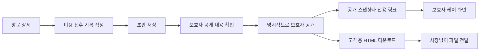

# 미용 기록·보호자 케어 확인 흐름

작성일: 2026-11-05 · 범위: 예약별 미용 기록과 보호자용 공개본. 기존 예약·결제 흐름은 [OWNER_UX.md](OWNER_UX.md), 화면 규칙은 [DESIGN_SYSTEM.md](DESIGN_SYSTEM.md)를 따른다.

## 1. 이번에 연결하는 업무

사장님이 방문 상세에서 미용 전후 사진과 관찰 내용을 기록하고, 보호자에게 전달할 내용을 확인한 뒤 공개한다. 보호자는 전용 화면에서 해당 아이의 공개된 방문 기록과 집에서 참고할 관리사항을 읽는다. 미용 기록 저장·공개는 예약 완료나 결제 기록을 대신하지 않는다.

이번 범위에는 예약별 `GroomingRecord`, 전후 사진·상태, 미용 소견, 보호자 관리사항, 다음 방문 권장일, 공개 스냅샷과 전용 링크, 고객용 HTML 파일 다운로드가 포함된다. 서버의 관리 API는 단일 사장님 비밀번호와 로그인 세션으로 보호하며 보호자는 공개 토큰으로 해당 아이의 공개 기록만 읽는다. 보호자 계정 로그인·본인 확인, 다중 기기 계정 동기화, 다중 매장·직원별 권한, 푸시·네이버 연동은 포함하지 않는다. 현재 접근 통제와 운영 설정은 [접근 권한](AUTHORIZATION.md)을 기준으로 한다.

## 2. 기록 항목과 공개 경계

| 항목 | 작성·표시 기준 |
| --- | --- |
| 예약 연결 | 예약별 한 기록. 방문 날짜·서비스·반려동물은 해당 예약의 정보를 기준으로 식별한다. |
| 미용 전 사진·상태 | `stage: before` 사진 최대 4장과 `beforeNotes`. 엉킴·피모 등 실제 관찰을 작성한다. |
| 미용 후 사진·상태 | `stage: after` 사진 최대 4장과 `afterNotes`. 실제 마무리 상태를 작성한다. |
| 미용 소견 | `groomerOpinion`. 진행한 미용과 관찰한 반응을 보호자가 이해할 수 있게 설명한다. |
| 집에서 관리 | `homeCare`. 보호자에게 전달할 빗질·관찰 등 참고사항을 직접 작성한다. |
| 다음 방문 권장일 | `nextVisitDate`. 권장일이며 예약 확정이나 알림 신청이 아니다. 미입력 상태를 허용한다. |
| 사진 설명 | 사진별 `caption`. 전후 구분과 사진 내용을 텍스트로도 확인할 수 있게 한다. |

사진은 JPEG로 저장하며 선택한 파일을 처리하지 못하면 이유를 표시한다. 실제 사진이 없으면 비워 두거나 사진 없음 상태를 보여준다. 스톡 이미지·기존 고객 사진을 해당 방문의 전후 사진으로 자동 채우지 않는다. 데모 자료를 쓰는 경우 실제 방문 기록처럼 설명하지 않는다.

미용 소견은 미용사가 관찰한 내용과 집에서 참고할 사항이다. 의학적 진단·처방을 자동 생성하지 않으며, 기존 고객대장의 건강·알레르기·행동 메모를 그대로 복사해 공개하지 않는다.

공개본 `PublicCareReport`는 허용된 필드를 별도로 구성한다. 반려동물 이름·견종·몸무게, 방문 날짜·서비스, 위에서 작성한 공개용 기록·사진, 공개 시각을 포함할 수 있다. `appointment.notes`의 내부 미용 메모, 보호자명·전화번호, 고객대장 참고사항, 금액·결제 수단·장부·원가·샴푸 사용 원가는 자동 포함하지 않는다. 공개용 입력란에 직접 쓴 내용과 사진은 보호자에게 보이므로 발행 전 미리보기에서 확인한다.

## 3. 사장님 흐름

1. **방문 확인:** 반려동물·방문 날짜·서비스를 확인하고 미용 기록을 연다. 다른 아이의 기록을 복사하거나 연결하지 않는다.
2. **기록:** 전/후 사진과 상태를 구분하고 소견·집에서 관리·다음 방문 권장일을 작성한다. 사진 삭제도 저장 전에는 편집 중인 내용이다.
3. **초안 저장:** 성공한 저장만 완료로 표시한다. 저장 실패·사진 처리 실패 때 작성한 텍스트와 정상 처리된 사진을 지우지 않는다. 새로고침 후 복원은 성공적으로 저장된 내용이 기준이며 미저장 입력까지 보장한다고 안내하지 않는다.
4. **공개 확인:** 저장과 구분된 `보호자 공개`를 누른다. 보호자가 볼 사진·문구를 확인하고 공개한다. 저장·결제·미용 완료만으로 자동 공개하지 않는다.
5. **전달:** 공개 성공 후 링크를 복사하거나 고객용 HTML을 다운로드한다. 실제 메신저 전송은 사장님이 수행하며 앱이 전송 성공으로 표시하지 않는다.
6. **수정:** 공개 후 초안을 수정해도 보호자가 보는 내용은 그대로다. 공개본을 바꾸려면 수정 내용을 저장한 뒤 명시적으로 다시 공개한다.

미용 기록 저장, 사진 수정, 공개, 공개 해제는 예약일·서비스 금액·미용 완료·결제 상태·장부 합계를 변경하지 않는다. 이미 정산한 방문의 기록을 보완하더라도 금전 잠금을 해제하지 않는다.

## 4. 초안·공개·해제 상태

| 상태 | 사장님에게 보여줄 내용 | 보호자에게 보이는 내용 |
| --- | --- | --- |
| 기록 없음 | 새 기록 작성 | 아직 공개된 기록 없음 |
| 저장된 초안 | 초안, 저장 상태, 공개 동작 | 초안은 조회 불가 |
| 공개됨 | 공개 상태·공개 시각·링크·해제 | 마지막으로 발행한 스냅샷 |
| 공개 후 초안 수정 | 수정 초안과 공개본이 다르다는 안내 | 기존 공개본 유지 |
| 다시 공개 성공 | 갱신된 공개 시각·공개본 | 새로 발행한 스냅샷 |
| 공개 해제 | 초안 보존·공개 해제 상태 | 이전 토큰으로 조회 불가 |

`publishedSnapshot`은 발행 시 복사한 데이터다. 고객대장·예약·초안을 나중에 수정하거나 사진을 교체해도 발행본을 자동 변경하지 않는다. 다시 공개하기 전까지 기존 내용이 전달된다는 사실을 안내한다. 다시 공개 실패 시 기존 공개본을 유지하고 초안도 보존한다.

공개 해제는 기존 `shareToken`을 폐기한다. 오래된 링크·새로고침·직접 조회가 이전 공개본을 다시 반환해서는 안 된다. 해제 후 다시 공개할 때는 폐기한 토큰을 되살리지 않고 새로운 토큰을 발급한다. 재발행 시에는 반환된 현재 링크를 복사하도록 하며, 이전 링크의 유효성을 임의로 보장하지 않는다.

예약 취소와 공개 해제는 별도 동작이다. 예약 취소가 이미 전달된 사진·파일을 회수했다는 인상을 주지 않는다. 잘못 공개한 방문은 사장님이 공개 해제하고, 필요한 내용을 수정한 뒤 새 공개본을 발행한다.

## 5. 보호자 케어 화면 정보 구조

진입 주소는 `/customer/care/?token=...`이며 기존 `?screen=care&token=...`도 호환한다. 관리자 메뉴·편집 버튼·금전 기능 없이 읽기 전용 화면으로 연다. 로그인한 보호자 계정이나 전체 고객대장이 아니다. 주소 구분 자체가 권한은 아니며 서버가 유효한 공개 토큰과 조회 범위를 확인한다.

| 화면 영역 | 내용과 동작 |
| --- | --- |
| 아이와 방문 | 반려동물 이름, 방문 날짜, 서비스. 여러 방문을 혼동하지 않게 한다. |
| 전후 기록 | 미용 전/후 사진을 각각 구분하고 상태·사진 설명을 함께 표시한다. 사진이 없으면 가짜 이미지를 넣지 않는다. |
| 미용 소견 | 해당 방문에서 작성해 공개한 관찰 내용 |
| 집에서 관리 | 공개된 `homeCare`. 비어 있으면 의료·관리 권고를 임의 생성하지 않는다. |
| 다음 방문 | 입력한 권장일. `예약 완료`로 표현하거나 예약을 자동 생성하지 않는다. |
| 지난 공개 기록 | 같은 아이의 유효한 공개 스냅샷만 날짜별 표시. 초안·해제된 방문은 제외한다. |

히스토리는 서버가 확인한 해당 반려동물의 연결을 기준으로 한다. 이름이 같다는 이유로 합치지 않으며, `petId`가 없는 방문에서 이름·보호자·전화로 다른 방문을 추정해 노출하지 않는다. 한 보호자의 다른 반려동물이나 다른 고객의 기록으로 이동할 수 없게 한다. 공개 링크로 고객 검색·초안 조회·상태 변경·메모 수정 API를 사용할 수 없다.

읽는 순서는 아이·방문 → 전후 상태 → 소견·집에서 관리 → 다음 방문 → 지난 공개 기록이다. 모바일은 한 열, 충분한 본문 크기와 사진 설명을 유지한다. 사진의 가로 격자 때문에 본문을 작게 줄이거나 전체 화면에 가로 스크롤을 만들지 않는다.

## 6. 실제 서버와 GitHub Pages 데모

### 서버 방식

서버는 암호학적으로 생성한 예측하기 어려운 토큰으로 공개 스냅샷을 읽기 전용 조회한다. 토큰은 계정 비밀번호나 본인 확인이 아니라 **링크를 가진 사람이 열 수 있는 권한**이다. 공개 안내에서 이를 명시한다. 토큰을 순차 예약 ID·전화번호 등으로 만들지 않는다.

서버의 예약·고객·정산·케어 초안과 공개 관리 API는 단일 사장님 로그인 세션으로 보호한다. 비밀번호가 설정되지 않으면 관리 API는 `503`으로 닫히며, 로그인하지 않은 방문자에게 관리 데이터를 반환하지 않는다. 보호자 토큰은 읽기 전용 공개 조회에만 쓰고 사장님 권한을 부여하지 않는다. 보호자 계정 본인 확인과 다중 매장 권한은 미구현이다. 실제 인터넷 운영에는 HTTPS·서버 배포·백업 구성이 별도로 필요하며, 자세한 세션·공개 API 계약은 [접근 권한](AUTHORIZATION.md)을 따른다.

### GitHub Pages 공유 체험

데모 데이터는 같은 브라우저 저장소에 있다. 같은 브라우저에서 사장님이 기록·공개하고 보호자 화면을 열어 흐름을 확인할 수 있다. 다른 기기·다른 브라우저에서 주소만 열면 해당 공개 데이터가 자동 전송되지 않는다. 링크 복사 성공을 다중 기기 공유 성공으로 표현하지 않는다.

저장소 초기화·시크릿 모드·브라우저 변경으로 데이터가 사라질 수 있다. 이 경우 `기록이 없습니다` 또는 데모 저장 방식에 맞는 안내를 제공한다. 유효하지 않은 토큰 화면에서 다른 고객의 데이터나 관리자 화면으로 자동 이동하지 않는다.

### 파일 전달 대안

고객용 HTML 다운로드는 이미지가 내장된 단일 파일이며 외부 이미지 로딩이나 스크립트 실행 없이 읽을 수 있게 한다. 사용자 입력은 안전하게 이스케이프한다. 관리자 데이터 전체를 숨겨 넣는 방식이 아니라 전달할 공개본만 포함한다. 미공개 초안을 내려받아 자동 전달하지 않는다.

사장님은 내려받은 파일을 메신저 등으로 직접 전달할 수 있다. 받는 기기와 메신저의 HTML 첨부·열기 지원에 따라 열람 방법이 달라지므로 모든 메신저에서 바로 미리보기가 된다고 보장하지 않는다. 파일은 다운로드 당시 내용이며 이후 초안 수정·재발행과 동기화되지 않는다.

## 7. 백업과 공개 권한

저장, 백업, 고객 전달은 서로 다른 동작이다. 초안 저장은 현재 데이터 저장소에 기록한다. 고객용 HTML은 전달용 공개본이며 편집 가능한 전체 기록·원본 백업이 아니다. 기존 장부 CSV만으로 사진·미용 기록·공개 상태를 복원할 수 있다고 안내하지 않는다.

전후 사진을 포함한 완전한 백업·가져오기를 제공하려면 예약 연결, 초안 필드, 사진, 공개 상태와 스냅샷, 토큰 폐기 상태를 포함하고 실제 복원을 검증해야 한다. 이번 범위에 없는 백업 기능을 메뉴·성공 안내로 미리 약속하지 않는다. 로컬 데이터에는 저장 용량 한계가 있으므로 저장 실패를 숨기지 않고, 성공 전까지 입력을 유지한다.

공개 링크는 전달 대상이 다시 공유할 수 있다. 공개 해제는 이후 서버 조회를 막지만 이미 열어 본 화면·스크린샷·다운로드·전달한 HTML을 회수하지 못한다. 공개 해제 안내에서 이 차이를 짧게 알린다. 브라우저 백업을 과거 시점으로 복원하면서 폐기된 토큰이 다시 유효해지는 복원 정책은 허용하지 않으며, 공개 권한을 안전하게 복원할 수 없는 경우 재공개로 새 토큰을 발급하는 절차가 필요하다.

## 8. 오류·취소·성공 기준

- 파일 형식·개수·처리에 문제가 있으면 해당 사진의 이유를 알려주고 다른 입력은 유지한다. 전/후 각각 4장 제한을 서로 구분한다.
- 저장 중 중복 저장·중복 공개를 막고, 서버 실패를 성공 문구나 링크로 표시하지 않는다.
- 공개 전 입력 취소와 공개 해제를 구분한다. 편집을 닫는 동작만으로 기존 공개본을 없애지 않는다.
- 공개된 내용이 없는 방문, 공개 후 수정한 방문, 해제된 링크, 다른 브라우저의 데모 링크에 각각 맞는 상태를 제공한다.
- 공개 해제 뒤 이전 토큰으로 스냅샷·히스토리를 조회할 수 없어야 한다. 히스토리에서도 해제된 기록을 제외한다.
- 같은 아이의 공개 이력만 조회하고 다른 아이·초안·연락처·금액·내부 메모는 응답 자체에서 제외한다.
- 저장·공개·해제·파일 다운로드 전후 예약 금액, 정산 횟수, 결제일·결제 수단, 장부 합계가 변하지 않아야 한다.
- 사용자 입력에 HTML·스크립트 형태의 문자열이 있어도 공개 화면과 다운로드 파일에서 텍스트로 처리한다. HTML 파일에 실행 스크립트나 내부 데이터가 섞이지 않아야 한다.
- 자동저장·전달·다중 기기 동기화는 실제 구현한 범위로만 안내한다. 스톡 사진을 실제 전후 기록으로 표시하지 않는다.

## 9. 이후 고객 앱 단계

보호자 로그인 후 여러 기기에서 자신의 반려동물과 공개 이력을 장기간 관리하는 흐름은 다음 단계다. 본인 확인·반려동물 연결·매장별 접근 권한·계정 해지와 데이터 보존을 함께 설계해야 한다. 공개 링크 열람을 이미 계정 연동이 완료된 것처럼 취급하지 않는다.

직원 작성·검토·공개 권한, 변경 이력, 공개 알림·방문 알림·푸시, 다음 방문 실제 예약 연결, 네이버 예약 연동은 각각 별도 기획과 검증이 필요하다. 이번 화면에는 동작하지 않는 고객 계정·알림 설정 메뉴를 늘리지 않는다.
