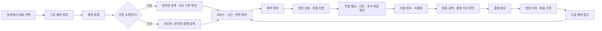
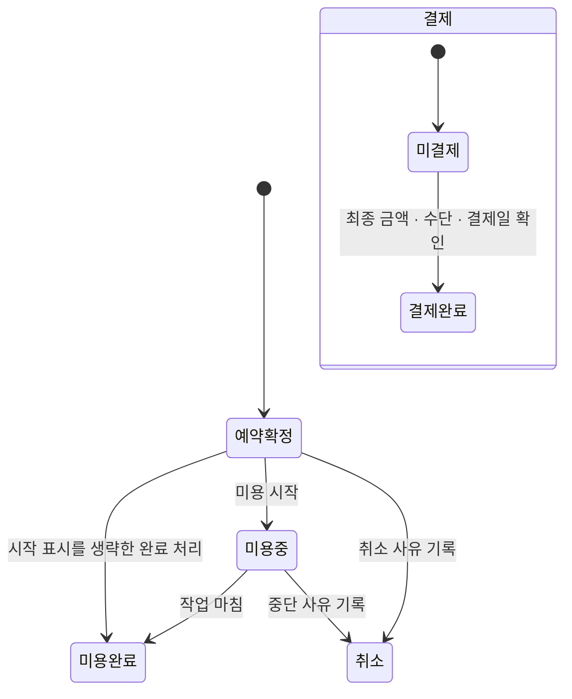

# 몽글 서비스 기획 · 화면 흐름 정의

작성일: 2026-10-29 (한국 시간) · 상태: **구현 전 검토안 v1**

[클릭해서 보는 화면 기획](https://mahyuna.github.io/toy_diary/planning/) · [시안 원본](../public/planning/index.html) · [이전 구현 상태](IMPLEMENTATION.md) · [조사 범위](RESEARCH.md)

## 1. 이 서비스가 해결하는 일

1인 애견미용사가 **예약을 받고 → 그날의 미용을 진행하고 → 금액을 확인해 결제받고 → 다음 방문에 지난 기록을 참고**하는 도구입니다. 각 단계가 같은 고객·반려견·방문 기록에 이어집니다. 미용 내용과 금액을 서로 다른 화면에 반복 입력하지 않습니다.

첫 버전은 매장 내부 관리용입니다. 보호자에게는 가격 안내표나 선택한 미용 기록 이미지만 전달합니다. 보호자가 직접 예약하는 공개 웹사이트, 직원 권한, 네이버 자동 연동은 다음 단계입니다.

### 이미 확인된 요구

- 운영자 한 명, 모바일 중심. 나중에 여러 직원으로 확장.
- 첫 화면은 스크롤 없는 월간 달력. 날짜마다 예약 건수와 미용 금액 표시.
- 오른쪽 아래에서 예약 등록. 예약 일정과 달력을 중복 메뉴로 만들지 않음.
- 보호자·견종·몸무게·미용 주의사항·과거 스타일·사진을 고객대장에 저장.
- 기본 금액에 입질·엉킴 등 실제 추가 작업 비용을 사유와 함께 반영.
- ‘미용표’는 **서비스·견종·몸무게별 가격 안내표**. 고객에게 보여주고 전달 가능.
- 정산과 매장 지출·수익 확인. 이후 네이버 예약 연동.

### 이번에 바로잡는 가정

**일반 샴푸 사용료를 기본 추가금으로 두지 않습니다.** 고객에게 기본 미용 가격을 안내하고 샴푸 구입비는 매장 운영비로 기록합니다. 제품 사용량으로 계산한 원가는 선택적인 내부 참고값이며, 고객 청구액이나 추가 현금 지출을 자동 발생시키지 않습니다.

특정 제품·스파·별도 관리가 실제 유료 서비스인지 확인되지 않았습니다. 그러한 메뉴가 매장에 존재한다면 이후 일반적인 선택 서비스로 정의합니다. 현재 기획에서 ‘샴푸를 썼기 때문에 추가 청구’하는 규칙은 제외합니다. 특정 업계의 보편적 관행으로 주장하지 않습니다.

## 2. 대표 사용자 시나리오

> 원장이 전화로 ‘두부, 비숑, 6.2kg, 토요일 10시 전체 미용’을 받는다. 달력에서 날짜를 누르고 두부를 검색한다. 지난 스타일과 발을 만질 때 예민하다는 주의사항을 확인한다. 시간과 서비스를 정하면 가격표 기준 견적이 표시된다. 예약을 저장한다. 방문 당일 미용을 진행하고, 엉킴 추가 작업이 생기면 사유·금액을 보호자와 확인해 기록한다. 완료 사진과 메모를 남긴다. 미용은 완료되었지만 결제를 아직 받지 않은 상태를 유지할 수 있다. 인계할 때 카드 결제를 기록하면 매출에 한 번 반영된다. 다음 방문 예약 시 사진과 메모를 다시 확인한다.

시나리오 금액은 설명용 예시입니다. 실제 표준가나 업계 표준 과정이 아닙니다.

## 3. 업무 흐름과 화면 연결

매장 가격표 준비는 예약의 선행 설정입니다. 샴푸 구매비·임대료 등 운영비 기록은 하루 업무와 별개의 보조 흐름이며, 예약마다 입력하도록 요구하지 않습니다.

## 4. 정보 구조

| 1차 메뉴 | 역할 | 포함 화면 |
| --- | --- | --- |
| 예약 | 언제 누구를 미용하는가 | 월간 달력, 날짜별 하단 목록, 예약 등록, 방문 상세 |
| 고객 | 어떤 아이이며 이전에 어떻게 미용했는가 | 고객 검색, 반려견 상세, 사진·방문 이력 |
| 장부 | 얼마를 받았고 무엇이 미결제인가 | 미용 내역, 실제 받은 금액, 운영비, 월별 차액 |
| 매장 | 반복 입력할 기준과 고객 안내 자료 | 가격 안내표, 요금 편집, 영업 설정, 선택적인 소모품 원가 |

장부 안에서 ‘미용 내역’과 ‘월별 수익’을 전환합니다. 기존의 ‘미용 장부’와 ‘운영비·손익’을 최상위 여러 메뉴로 벌리지 않습니다. ‘예약 일정’이라는 별도 페이지는 만들지 않습니다.

## 5. 페이지·하단 창 정의

| ID / 유형 | 화면 | 진입과 목적 | 핵심 내용 | 주 동작 · 다음 화면 |
| --- | --- | --- | --- | --- |
| P01 / 페이지 | 예약 달력 | 앱 첫 화면 | 월 이동, 날짜, 예약 건수, 견적 합계. 목록·통계·배너는 달력 아래에 붙이지 않음 | 날짜 → S01, ＋ → S02 |
| S01 / 하단 창 | 날짜별 예약 | 날짜 누름 | 시간순 예약, 반려견, 서비스, 금액, 미용·결제 상태. 한 방문 한 줄 | 예약 선택 → P03, 예약 추가 → S02 |
| S02 / 하단 창 | 예약 등록·변경 | 달력 ＋, 날짜 목록, 고객 상세 | 고객 검색·신규 등록, 날짜·시간·소요 시간·서비스, 견종·체중 견적 | 예약 저장 → 해당 날짜 목록. 취소 → 진입 화면 |
| S03 / 하단 창 | 신규 고객 빠른 등록 | 예약 중 검색 결과 없음 | 보호자명·연락처, 반려견명·견종·체중. 나머지는 나중에 입력 가능 | 등록하고 계속 → S02로 복귀, 자동 선택 |
| P03 / 상세 페이지 | 한 번의 방문 | 날짜 예약 선택, 방문 이력 선택 | 반려견 요약, 주의사항, 서비스·견적, 메모·사진, 상태별 동작 | 미용 시작 / 완료 / 결제 확인. 뒤로 → 진입 화면 |
| S04 / 하단 창 | 작업·금액 수정 | 방문 상세 | 스타일·메모, 사진, 실제 추가 작업 사유·금액, 수정 합계 | 저장 → P03. 금액 변경 전후 확인 |
| S05 / 하단 창 | 결제 확인 | 미용 완료된 방문 | 최종 금액, 항목 내역, 카드·현금·이체, 실제 결제일 | 결제 기록 → P03의 결제 완료 상태 |
| P04 / 페이지 | 고객 | 고객 탭 | 반려견·보호자·연락처 검색, 최근/다음 방문 | 반려견 선택 → P05, ＋ → S03 |
| P05 / 상세 페이지 | 반려견 고객대장 | 고객 목록·방문 반려견 이름 | 보호자, 기본 정보, 주의사항, 이전 스타일, 방문별 사진·메모 | 예약 잡기 → S02에 고객 정보 채움 |
| P06 / 페이지 | 장부 | 장부 탭 | 미용 내역(방문일), 미결제, 월별 받은 금액·운영비·차액(거래일) | 방문 → P03, 비용 기록 → S06 |
| S06 / 하단 창 | 운영비 기록 | 장부의 비용 기록 | 날짜·분류·금액·메모. 샴푸 구매도 이곳 | 저장 → 장부 갱신 |
| P07 / 페이지 | 매장 | 매장 탭 | 가격 안내표, 요금 설정, 보조 운영 설정 | 가격표 → P08 |
| P08 / 페이지 | 고객용 가격 안내표 | 매장, 예약 견적의 가격 기준 보기 | 서비스·견종·체중별 요금, 적용 방식, 매장명 | 크게 보기 / 이미지 저장·공유 / 요금 편집 |
| S07 / 하단 창 | 요금 편집 | 가격 안내표의 편집 | 기본 서비스·시간·기본가, 견종·체중 기준 | 저장 → P08. 이전 예약 견적은 보존 |
| S08 / 하단 창 | 고객용 안내 미리보기 | 가격표·방문 상세 | 전체 가격표 또는 선택 견적. 미용 기록은 사진·안내 문구 직접 선택 | 이미지 저장 / 기기 공유. 예약·장부에는 영향 없음 |

P는 별도 페이지, S는 현재 맥락을 유지하는 하단 창입니다. 신규 등록을 위해 고객 메뉴로 나갔다가 다시 돌아오게 하지 않습니다. 하단 창 위에 여러 입력 창을 쌓지 않고 예약 초안을 유지하며 단계를 교체합니다.

## 6. 주요 화면 와이어프레임 기준

### P01 예약 달력

상단 매장명 → 월 이동 → 일~토 달력 → 하단 탭. 오른쪽 아래 예약 ＋. 날짜 칸에는 날짜, 예약 건수, 해당 방문일의 견적 합계를 보여줍니다. 합계는 **예약 금액**으로 표기하며 미래 견적을 매출이라고 부르지 않습니다. 6주 달력도 기본 모바일 세로 화면에서 탭과 ＋에 가리지 않습니다.

### S02 예약 입력

1. **누가 오나요:** 기존 반려견 검색 또는 신규 등록. 선택 시 견종·체중·최근 스타일 자동 표시.
2. **언제, 어떤 미용인가요:** 날짜·시작·소요 시간·서비스. 동일 담당자 일정 겹침 즉시 안내.
3. **예상 금액:** 가격표 기준 항목과 합계. 추가 작업은 필요할 때만 펼침.

하단에 합계와 예약 저장을 고정합니다. 사진·건강 세부 항목·샴푸 원액량을 예약 필수 입력에 넣지 않습니다. 저장 실패 시 초안 유지, 저장 중 중복 제출 방지.

### P03 방문 상세

상단 뒤로 → 반려견·보호자·시간 → **미용 전 확인할 주의사항** → 선택 서비스·견적 → 사진·작업 메모 → 상태별 주 동작. 미용 중에는 ‘작업 기록’, 미용 완료 후 미결제이면 ‘결제 확인’이 주 동작입니다. 완료 사진은 방문에 연결하고 고객대장에도 그 방문의 사진으로 모읍니다.

### P06 장부

기본은 방문별 미용 내역. 월 이동과 방문일·반려견·미용 금액·결제 여부를 확인합니다. ‘월별 수익’에서는 실제 받은 금액과 운영비를 확인합니다. 방문일 기준 금액과 실제 결제일 기준 매출을 같은 합계로 섞지 않습니다. 과거 방문을 오늘 결제하면 방문 이력은 과거 날짜에, 받은 금액은 오늘에 기록합니다.

### P08 가격 안내표

고객에게 보여줄 자료가 기본입니다. 서비스 기본가·견종·체중 기준을 한 화면에서 읽고, 조건별 예상 금액을 설명할 수 있어야 합니다. 편집은 보조 동작입니다. 일반 샴푸를 일괄 추가금으로 안내하지 않습니다. 현장에서 추가 비용이 생기면 사유·금액을 먼저 확인하고 별도로 기록합니다.

## 7. 상태 정의와 금액 규칙

위 그림의 미용 상태와 결제 상태는 독립된 축입니다. 미용 완료를 눌렀다고 결제를 자동 기록하지 않습니다. 결제 완료는 실제 결제 확인 동작에서만 발생합니다. 첫 범위에서는 결제 확인을 미용 완료 이후에 제공합니다. 선결제·예약금·부분 결제·환불은 별도 후속 설계가 필요합니다.

| 상황 | 처리 기준 |
| --- | --- |
| 미용은 끝났지만 보호자가 아직 오지 않음 | 미용 완료 / 미결제 |
| 사진이나 샴푸 사용량을 기록하지 않음 | 미용 완료와 결제 가능. 필수 단계가 아님 |
| 추가 작업이 생김 | 사유·추가금 기록 및 보호자 확인 여부 표시. 사전 견적을 몰래 덮어쓰지 않음 |
| 미용 시작 표시를 놓침 | 방문 상세에서 바로 미용 완료 가능. 실제 시작 시각을 추정해 만들지 않음 |
| 미결제 예약의 일정 변경 | 겹침 확인 후 변경, 금액·기존 메모 보존 |
| 취소 | 슬롯 반환, 기록 보존. 실제 결제된 건을 취소만으로 지우거나 환불 처리하지 않음 |
| 결제를 두 번 누름 | 한 번만 반영, 이미 결제된 상태 안내 |
| 결제 후 금액 정정 필요 | 첫 범위에서는 수정 잠금과 정정 미지원 안내. 이후 취소·환불 이력 설계 |
| 저장 실패 | 입력 유지, 성공 상태·매출에 반영하지 않음 |

**예상 미용 금액 = 서비스 기본가 + 적용 견종 추가금 + 적용 체중 추가금 + 확인된 추가 작업 비용.** 샴푸 원가를 고객 금액에 자동 더하지 않습니다. 가격표가 바뀌어도 이미 저장한 견적과 과거 결제 금액은 그대로 보존합니다.

**월별 실제 수입 = 실제 결제일에 기록한 금액 합계. 월별 차액 = 실제 수입 − 기록한 매장 지출.** 구매 지출과 참고용 사용 원가를 두 번 빼지 않습니다. 회계상 순이익·은행 잔액이라고 표현하지 않습니다.

## 8. 데이터 연결

- 보호자 → 여러 반려견 → 여러 방문. 한 방문에 예약·미용·결제 정보를 이어서 표시.
- 방문에는 예약 당시 서비스·몸무게·견적 항목, 실제 작업 메모·완료 사진, 결제 사실을 보존.
- 사진은 기본적으로 **어느 방문의 사진인지** 연결. 프로필 사진·이전 스타일 참고 사진은 별도 구분.
- 가격표는 새 예약의 기준. 방문 견적은 그때의 스냅샷.
- 매장 운영비는 방문과 별개. 제품 구매와 제품 사용량을 다른 의미로 저장.
- 고객용 공유물은 공개할 가격 또는 명시적으로 선택한 사진·안내만 포함. 연락처·건강·행동 메모는 자동 포함하지 않음.

## 9. 기존 구현과 새 기획의 차이

| 현재 구현에서 남아 있는 문제 | 새 기준 | 이행 시 유의점 |
| --- | --- | --- |
| 미용 완료와 결제를 한 동작으로 저장 | 작업 완료와 결제 확인 분리 | 기존 결제된 방문의 금액·결제일 보존 |
| 샴푸 고객 추가금 입력과 예시가 있음 | 일반 샴푸는 기본 미용에 포함, 구매는 운영비 | 과거에 저장된 실제 금액을 일괄 삭제·감액하지 않음. 새 기본 입력에서 분리 |
| 사진이 반려견에만 연결됨 | 방문별 사진 + 프로필 구분 | 기존 사진은 ‘방문 미연결’로 보존, 날짜만으로 임의 연결하지 않음 |
| 신규 고객 등록이 예약과 분리됨 | 예약 작성 중 빠른 고객 등록 | 초안 유지, 보호자 중복 생성 방지 |
| 미용 장부와 운영비 화면이 각각 있음 | 장부 안에서 내역·월별 수익 전환 | 방문일과 거래일 기준을 화면에 명시 |
| 유료 옵션을 검증 없이 일반화 | 매장 실제 서비스만 요금표에 등록 | 네트워크 조사 실패를 업계 관행으로 대체하지 않음 |

이 문서와 클릭 시안은 **새 구현 제안**입니다. 현재 앱이 위 모든 흐름을 이미 지원한다는 의미가 아닙니다. 검토 페이지의 동작은 가상 데이터이며 고객 정보·예약·결제 내역을 저장하지 않습니다.

## 10. 구현 순서와 완료 기준

1. **흐름 검토:** 이 문서·클릭 시안으로 신규 예약, 당일 미용, 미결제 완료, 결제, 재방문 시나리오를 확인.
2. **업무 뼈대:** 달력 → 날짜 목록 → 예약 → 방문 상세. 기존 고객·신규 고객 모두 한 흐름에서 예약.
3. **작업과 결제:** 독립 상태, 추가금 확인, 방문 사진, 결제 중복 방지, 실패 복구.
4. **가격표와 장부:** 고객 가격 안내·견적 공유, 실제 결제일 매출·운영비·차액.
5. **운영 기반:** 로그인·매장 구분·기기 간 저장·백업·복구와 사진 용량 관리. 실데이터 운영의 출시 조건.
6. **확장:** 직원별 일정, 예약금·환불, 공식 지원 범위를 확인한 네이버 연동.

완료는 버튼 개수가 아니라 다음 결과로 판단합니다. 재방문 고객을 재입력하지 않고 예약할 수 있음 / 미용 완료가 결제를 발생시키지 않음 / 고객 사진을 방문별로 다시 찾을 수 있음 / 가격표를 보호자에게 실제 전달할 수 있음 / 결제·운영비가 장부에 한 번만 반영됨 / 저장 실패와 취소에서 기록이 사라지지 않음.

## 11. 운영자와 확인할 결정

다음은 답이 없어서 구현을 막는 질문이 아니라, 검토 시 바꿀 수 있는 가정입니다.

1. 서비스 이름·기본가·체중 구간·견종 기준: 실제 매장 가격표를 기준으로 확정. 숫자는 시안용.
2. 연락처 없이 예약을 받아야 하는 경우가 있는가: 현재 시안은 보호자·반려견 이름을 우선, 연락처 필수 여부는 검토.
3. 입질·엉킴 추가금은 어떤 시점에 어떻게 보호자에게 확인받는가: 우선 안내 여부를 명시적으로 기록하는 안.
4. 결제는 보통 인계 시 한 번인가: 현재 기본안은 완료 후 결제. 선결제·예약금은 실제 필요 확인 후 별도 설계.
5. 별도로 판매하는 스파·관리 서비스가 실제 있는가: 없다면 기본 메뉴에 넣지 않음.
