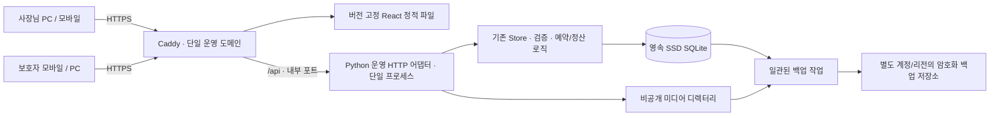
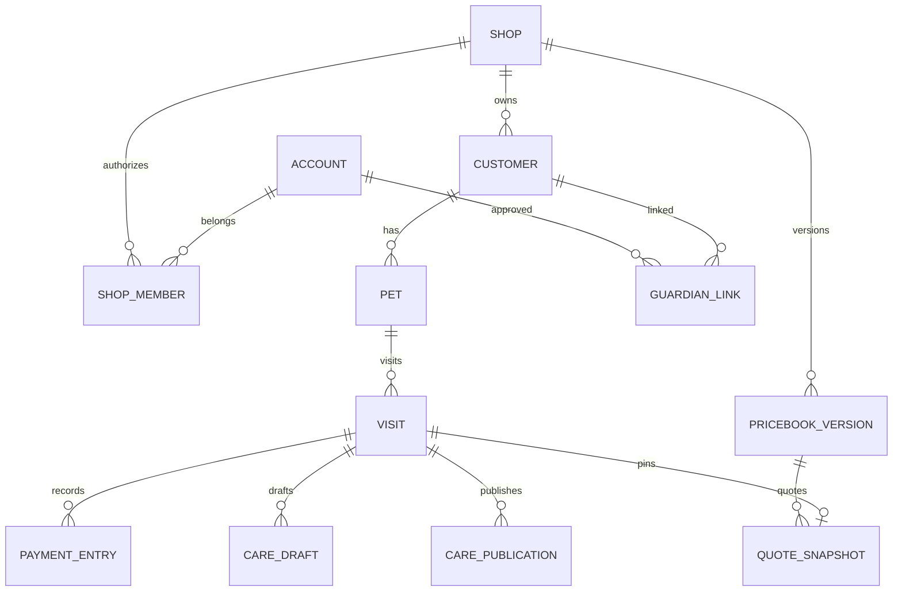

# 몽글 실서비스 전환안

작성: 2026-11-05 · 근거 코드: `b105ff8` · 상태: 분석·설계 제안, 운영 구현/배포 전

**목표는 우리 매장 실운영 → 운영 경험으로 개선 → 검증 후 타 매장 SaaS다.** Pages 체험 사이트는 운영 제품이 아닌 가상 데이터 검토 도구로 한정한다. 기존 서버의 업무 로직과 데이터를 재사용한다. 이번 산출물은 계획과 시안이며 앱 코드·운영 DB·공개 사이트는 변경하지 않았다.

- [UI/UX 설계](UX.md) / [클릭 가능한 화면 시안](preview.html)
- [우선순위·완료 조건·전환 절차](EXECUTION.md) / [이번 검증 범위](VALIDATION.md)
- 판단 구분: **현재**는 코드에서 확인한 사실, **제안**은 미구현 결정안, **확인 필요**는 실제 환경/운영자 확인이 필요한 항목이다.

## 1. 먼저 결정할 방향

1. React/TypeScript와 Python/SQLite를 유지한다. 전면 재작성이나 즉시 PostgreSQL 이전은 하지 않는다.
2. 운영 주소 하나에서 프런트와 API를 제공하고, 모든 기기가 같은 서버를 사용한다. 휴대폰별 localStorage를 장부로 사용하지 않는다.
3. 운영 첫 버전은 단일 매장·사장님 한 명, 보호자 계정은 승인된 고객 연결만 허용한다. 데이터에는 매장 소유 경계를 준비하되 SaaS 회원가입·과금은 보류한다.
4. **요금표와 예약 견적의 분리, 예약/미용/결제 상태 혼합, 복구 불가능한 운영 배포**를 출시 전 해결한다. 기능 개수를 먼저 늘리지 않는다.
5. UI 재설계는 공통 토큰과 업무 흐름부터 검증한다. 기존 분홍색·꽃 장식·카드 구성 등을 앱 전체의 고정 조건으로 보지 않는다. 매장 요금표 이미지의 브랜딩은 별도 출력 테마로 유지할 수 있다.

## 2. 현재 구현: 재사용할 것과 출시를 막는 것

| 영역 | 현재 확인 | 재사용 / 출시 전 보완 |
|---|---|---|
| 빌드 | `vite.config.ts`: demo는 `demo-dist`, 서버용은 `dist`; `__MONGLE_DEMO__`로 분기 | 기존 분기 유지. 운영 산출물에 체험 어댑터·예시 계정·샘플 고객이 들어가지 않는 검사 추가 |
| API/업무 | `server/app.py`의 Store, 입력 검증, `BEGIN IMMEDIATE`, 예약 겹침 검사 | 로직 재사용. HTTP 계층만 운영에 맞춰 얇게 분리 |
| 정산 | 이미 결제된 예약 재정산 거절, 취소 예약 결제 거절, 금액 스냅샷 보존 | 보호 규칙 유지. 재시도 멱등성·감사 로그·정정 절차 추가 |
| 상태 | `settle()`가 미용 상태를 completed, 결제를 paid로 동시에 변경 | 미용 완료·미결제를 독립 표현하도록 상태 전환 분리. 과거 완료/결제 기록은 재해석하지 않음 |
| 고객/케어 | 고객·반려견 대장, 전후 사진, 방문 당시 체중, 비공개 초안/공개본 | 데이터·공개 경계 재사용. 목록 페이지네이션·이미지 분리·인계 흐름 정리 |
| 보호자 권한 | `customer_access.py`: scrypt 비밀번호, 별도 세션, 사장님 승인 연결, 공개 기록만 조회 | 기반 재사용. 연락처 소유 확인·안전한 계정 복구·승인 감사 기록 필요 |
| 사장님 권한 | 환경변수의 공통 비밀번호, 메모리 세션, 실패 횟수 제한 | 운영 계정·느린 비밀번호 해시·회수 가능한 세션으로 전환. 환경변수 비밀번호는 초기 설정용으로 제한 |
| 요금 | `price-menu`와 고객·사장님 표는 공유. 자동견적은 별도 `settings.pricing` | **가격 원본 통합 미완료.** 자유 텍스트 구간/가격을 계산 가능한 모델로 매핑·검수해야 함 |
| 게시 이미지 | 표와 일치하는 이미지에 한해 노출하는 프런트 검사, 편집기는 브라우저 초안 보유 | 서버에서 버전·소유권 검증. 이미지·텍스트·견적을 같은 게시 버전에서 생성 |
| 데이터 동기화 | 서버판은 같은 DB에 저장. 화면은 변경/월 이동 등에 재조회; `storage` 이벤트는 브라우저 내 동기화 | 다른 PC/모바일에서 화면 자동 갱신·오래된 편집 충돌 처리가 아직 없음 |
| DB 운영 | SQLite 파일, SQL/JSON 혼합, 시작 시 ALTER, 연결별 외래키 강제/WAL 설정 없음 | 버전형 마이그레이션·고아 참조 검사·백업/복구·잠금 측정 필요 |
| 서버 운영 | `ThreadingHTTPServer`, 표준 라이브러리 개발 진입점. 저장소에 운영 서비스/백업/CI 설정 없음 | 공개 운영 HTTP 경계, 감독 프로세스, HTTPS, 모니터링, 배포·복원 절차 필요 |
| 이미지 | base64 JPEG를 DB JSON에 저장. 서버는 크기·base64·JPEG 시작/끝 검사 | 실제 디코딩/재인코딩·메타데이터 제거, 비공개 미디어 저장·인가·썸네일 필요 |
| 보안 기초 | 관리 API 세션 검사, Origin 검사, HttpOnly/SameSite, 선택적 Secure 쿠키, API no-store | 좋은 기반. 공개 예약 스팸 방어·복구·TLS 프록시 신뢰·로그 비식별화·운영 점검 필요 |
| UI | 화면/역할별 스타일과 후속 override가 여러 CSS에 누적, 폼/모달/표 패턴 혼재 | 화면 전체 폐기 대신 공통 컴포넌트로 흐름 단위 교체 |
| 문서 | 초기 체험판 방향과 최근 운영 계정 설명이 함께 남아 있음 | 본 문서를 새 방향 기준으로 삼고, 구현 완료마다 구문서를 갱신 |

근거 파일: `src/types.ts`, `src/demo/api.ts`, `src/App.tsx`, `src/SharedPricing.tsx`, `src/shared-price-menu.ts`, `src/OwnerSession.tsx`, `src/GuardianNotebook.tsx`, `server/app.py`, `server/customer_access.py`, `server/price_menu.py`. 실제 고객 DB의 내용·규모는 열람하지 않았다.

## 3. Pages와 서버 운영의 차이

| 항목 | GitHub Pages 현재 | Python 서버 현재 | 실운영 목표 |
|---|---|---|---|
| 저장 | 브라우저별 localStorage | 서버 SQLite | 영속 디스크의 단일 DB, 접근 통제된 미디어 |
| PC↔모바일 | 공유되지 않음 | 같은 API 접속 시 같은 DB | 저장 후 즉시 서버 확정, 활성 화면 재조회·충돌 검출 |
| 인증 | 임시 역할 자동 진입. 보안 권한 아님 | 사장님/보호자 세션, 서버 권한 검사 | 운영 계정·복구·회수·매장 소유 검사 |
| TLS | Pages 주소의 정적 HTTPS | 코드 자체에는 인증서 운영 구성 없음 | 앱 도메인의 인증서 자동 갱신·HTTPS 강제 |
| 재시작 | 브라우저 저장소에 의존 | 프로세스 재시작 시 세션 소멸, DB는 지정 경로에 존재 | DB 보존·서비스 재시작·백업/배포 복구 확인 |
| 이미지/기록 공유 | 같은 브라우저 데이터에 의존 | 서버 공개 스냅샷/보호자 계정에서 조회 | 계정 권한 중심, 개별 링크는 선택적·회수 가능 |
| 백업 | 서비스 백업 체계 아님 | 구현된 자동 원격 백업 없음 | 별도 저장소의 암호화 백업·검증된 복원 |
| 용도 | 가상 데이터 검토 | 운영 기능의 기반 | 실제 고객 데이터를 다루는 단일 매장 서비스 |

**Pages에서 운영으로 기존 localStorage를 자동 업로드하지 않는다.** 샘플·체험 입력·실제 자료가 섞일 수 있고, 신뢰할 수 있는 원장도 아니다. 운영 시작 전까지 가상 정보만 사용한다. 이미 실제 정보가 입력됐다면 임의 삭제하지 않고, 소유자가 확인한 자료만 안전하게 분리·이관하는 별도 절차를 따른다.

## 4. 권장 운영 배포 구조

**권장안:** 관리 가능한 Linux 서버 1대 + 영속 로컬 SSD + Caddy + systemd/동등한 프로세스 관리자 + 별도 원격 백업 저장소. 2 vCPU/4GB는 초기 부하 검증의 출발점일 뿐 용량 보장이 아니다. 실제 이미지 수·업로드량·예약 조회 부하를 측정해 조정한다. 공급자·리전·도메인은 아직 선택하지 않았고 월 비용도 확정하지 않았다.

- React `dist`와 API를 같은 도메인에서 제공. `/owner/`와 `/customer/`는 그대로 재사용한다. 초기에는 CORS가 필요한 별도 프런트 도메인을 만들지 않는다.
- 기존 `BaseHTTPRequestHandler`를 그대로 Gunicorn에 물릴 수는 없다. **업무 로직을 유지하고** 운영용 ASGI HTTP 어댑터(FastAPI/Starlette 중 최소 의존성 선택)를 만든다. URL·상태 코드·응답 계약을 유지하며 HTTP 테스트를 통과시키는 범위의 교체다. 기존 개발 진입점은 전환 기간 참조로 보존한다.
- 단일 프로세스/단일 DB로 시작. 세션을 DB 기반으로 정리하기 전 다중 worker는 사용하지 않는다. SQLite를 여러 서버의 네트워크 파일시스템에 공유하지 않는다.
- 배포물과 데이터 경로를 분리: 예시 `/opt/mongle/releases/<revision>` / `/var/lib/mongle/app.sqlite` / `/var/lib/mongle/media`. 실제 경로는 운영 설정으로 정한다. 릴리스 교체·재부팅·인스턴스 교체에서 데이터가 사라지지 않는지 시험한다.
- API 포트는 외부 차단. Caddy가 TLS 종료·호스트 검증·요청 크기/속도 제한·타임아웃을 담당하고 애플리케이션에서도 검증한다. 신뢰 프록시만 원래 호스트/클라이언트 정보를 제공할 수 있게 한다.
- `MONGLE_SECURE_COOKIES=true`는 TLS 설정이 아니라 쿠키/Origin 동작 설정이다. 실제 HTTPS에서 로그인·업로드·로그아웃·외부 Origin 차단을 검증한다.
- systemd 자동 재시작, 디스크 사용량·백업 실패·오류율·잠금 지연·인증 실패 알림, 로그 회전 필요. 로그에는 전화번호·본문·사진·세션·토큰을 남기지 않는다.
- 개발/스테이징/운영의 DB·키·도메인·백업 권한을 분리. 실고객 자료를 기본 스테이징 데이터로 복사하지 않는다.

대안: 영속 볼륨을 보장하는 관리형 컨테이너 호스팅도 가능하나 볼륨 귀속·슬립/재시작·백업 내보내기·복원·단일 인스턴스 제약을 먼저 검증한다. 영속성이 확인되지 않은 무료 정적/임시 디스크 호스팅은 운영 후보에서 제외한다.

## 5. PC·모바일 동기화와 동시 수정

- 운영의 유일한 저장소는 서버. localStorage는 장부/권한의 근거로 사용하지 않는다. 브라우저 새로고침만으로 최신 데이터 조회가 가능해야 한다.
- 초기에는 활성 화면 15초 주기 + 포커스 복귀 + 명시적 새로고침 + 변경 성공 직후 재조회로 충분한지 검증한다. **설계 목표**는 다른 활성 기기에 15초 안에 반영. WebSocket부터 도입하지 않는다.
- 레코드 `version`/ETag와 조건부 수정으로 오래된 편집은 409 반환. 사용자 입력을 보존하고 ‘서버 최신값 확인 → 다시 적용’ 선택 제공. 요금표·공지의 통째 배열 덮어쓰기도 버전 검사 필요.
- 예약 생성·확정·결제 기록에 idempotency key와 유일 제약 추가. 통신이 끊겼다면 결과 조회 후 재시도하며 버튼 재클릭으로 중복 예약/수입이 생기지 않아야 한다.
- 연결이 끊기면 ‘서버 확인 전’ 상태. 저장 성공처럼 표시하지 않는다. 초기 오프라인 예약/결제 쓰기는 지원하지 않으며, 작성 중 화면은 세션 안에서 보존한다. 민감한 초안을 장기 localStorage에 남기지 않는다.
- 서버 시간은 UTC 저장/일관된 생성 시각, 업무 날짜와 영업일은 Asia/Seoul. 23:59/00:00·결제일/방문일 경계 테스트를 둔다.

## 6. 인증·고객 연결·개인정보 경계

| 주체 | 초기 운영 권한 | 중요한 제한 |
|---|---|---|
| 익명 | 게시 요금·공지·예약 가능 시간, 제한된 신청 | 고객 대장/개별 수첩/연락처·내부 메모 조회 금지 |
| 사장님 | 자기 매장 예약·고객·장부·매장관리 | 환경변수의 공통 비밀번호를 장기 계정 체계로 쓰지 않음 |
| 연결 전 보호자 | 자기 계정, 연결 상태/신청 | 전화번호를 입력했다는 이유로 고객 기록 연결 금지 |
| 연결된 보호자 | 승인된 아이의 공개 수첩, 본인 예약의 허용 행동 | 다른 보호자/아이/매장·내부 메모·원가 금지 |
| 선택적 공유 링크 | 명시적으로 공개한 한정 기록 | bearer 권한임을 유지. 링크 소유를 로그인/본인 인증으로 간주하지 않음 |

운영 전: 사장님 계정 생성/복구 절차, scrypt 등 느린 비밀번호 해시, 세션 해시/만료/회수 영속화, 비밀번호 변경 시 세션 회수, CSRF/Origin·쿠키 회귀 검증. 보호자 승인 연결 기반은 유지하되 가입/비밀번호 복구 시 연락처 소유 확인을 마련한다. SMS 공급자가 없으면 사장님이 기존 연락처로 직접 확인하는 제한된 온보딩과 복구 절차를 먼저 문서화하고, 이를 자동 본인 인증처럼 안내하지 않는다.

현재 보호자 계정의 전화번호는 전역 UNIQUE, 고객 연결은 customerId UNIQUE다. SaaS/복수 보호자 정책과 충돌할 수 있으므로 조기에 모델을 정하되 기존 링크를 조용히 재배정하지 않는다. 모든 연결·해제·복구는 행위자/시각/대상만 감사 기록한다.

개인정보 수집 목적·최소 항목·보관/삭제·사진 공유 동의를 운영 전 정리한다. 실제 법적 의무/보관기간은 운영 지역과 사업 형태에 맞춰 별도 검토한다. 삭제 요청도 결제·회계 보존 기록의 무조건 삭제로 처리하지 않는다.

## 7. 백업·복원 계획

**초기 목표(검증 전 제안): RPO 1시간, RTO 4시간.** 실제 매장에서 허용할 손실/중단 시간 확인 후 고정한다. 복원 시간은 목표이지 현재 보장치가 아니다.

1. 매시간 SQLite online backup API로 일관된 스냅샷 생성. 실행 중 DB 파일만 `cp`하지 않는다. WAL 도입 시 DB/WAL 불일치 방지.
2. 미디어·DB·마이그레이션 버전·앱 revision·해시 목록을 동일 백업 세트의 manifest로 묶는다. 백업 중 사진 삭제는 유예해 참조 파일 누락을 막는다. 사진을 DB에서 옮기기 전에는 DB 안 base64도 백업 대상이다.
3. 암호화·전송 후 별도 계정/저장소에서 보관. 예시 보존 정책: 시간별 48시간, 일별 30일, 주별 12주. 이는 백업 운영 제안이며 개인정보/회계 보관기간을 대신하지 않는다.
4. 백업 실패/지연·원격 검증 실패·디스크 임계치 알림. 키는 소스/DB와 분리하고 복구 담당자가 접근할 수 있게 보관한다.
5. 매월 격리 환경에 복원: `integrity_check`, FK/고아 참조, 고객/예약/케어 건수, 결제 수단·일자별 합계, 공개 상태, 사진 체크섬과 실제 표시 확인. 최초 오픈 전에 최소 1회 전체 훈련.
6. 사고 시 쓰기 중지 → 현재 상태도 별도 보존 → 새 경로에 복원 → 검증 → 운영 경로 전환. 기존 DB 위에 덮어쓰지 않는다. RPO 구간 중 누락된 예약/결제는 별도 기록과 대조해 수동 재등록 여부 결정.
7. 코드 롤백과 데이터 복원을 구분한다. 스키마가 바뀐 DB에 구버전 앱을 임의 실행하지 않는다. 외부 결제/알림의 중복 실행도 차단한다.

## 8. 단일 매장에서 SaaS로 갈 데이터 모델

### 제안 관계

- 첫 운영 DB에 매장 하나를 생성하고 소유 데이터에 `shop_id`를 순차 추가한다. 기존 id·예약 일자·결제 금액·방문 스냅샷은 변경하지 않는다. 사용자 입력 shop_id를 권한으로 신뢰하지 않고 서버의 소속/선택 매장 검증을 거친다.
- 대상: 고객·반려견·예약 신청/방문·결제/지출·케어·요금 버전·공지·미디어·감사 로그. 보호자 계정은 전역 정체성, 고객대장은 매장 소유로 구분한다. 같은 번호의 타 매장 고객을 자동 병합하지 않는다.
- SQL은 저장소 경계에서 매장 범위를 강제. 향후 FK/UNIQUE도 `(shop_id, id)` 관계를 검증한다. 현재 글로벌 외부예약 유일성은 추후 `(shop_id, source, externalId)`로 검토한다.
- `staffId='owner'`를 바로 멤버 계정 id로 덮어쓰지 않는다. 최초 멤버 매핑을 별도 남기고 기존 원문 보존.
- 다중 매장 가입/직원 권한/요금제/플랫폼 관리자 기능은 운영 경험 이후. 매장 두 개의 격리 공격 테스트를 통과하기 전 SaaS로 공개하지 않는다.
- 여러 인스턴스·빈번한 동시 쓰기·DB 잠금/백업 시간이 실제 요구를 넘으면 PostgreSQL로 이전한다. 이전 트리거는 측정값/운영 요구로 정하며 단순 가입 매장 수만으로 결정하지 않는다.

### 예약·미용·결제

예약 신청(`requested/accepted/rejected/expired`) → 확정 방문(`scheduled/arrived/in_service/completed/cancelled/no_show`)과 결제(`unpaid/paid/...`)를 분리한다. 초기의 환불/부분결제 정책은 결정 전이며 자동 지원으로 표시하지 않는다.

결제 기록은 PG 결제가 아닌 매장에서 받은 결제의 기록이다. 기존 `appointments`의 paid 필드를 보존하며 점진적으로 원장 `payment_entries`에 초기 대응 행을 만든다. 1:1 대조 후 새 읽기 경로로 전환한다. 정정은 이력/취소 항목으로 남기고 과거 수입 합계를 직접 덮어쓰지 않는다. 기존 completed+paid를 방문 단계가 과거에 실제로 언제 진행됐다는 기록으로 추정하지 않는다.

### 요금 원본·게시물·예약 견적

| 객체 | 책임 |
|---|---|
| 서비스/견종 그룹/체중 구간 | 안정된 id, 포함 견종, 숫자 경계·단위·최대값 포함 여부, 소요 시간 |
| 요금표 초안 | 같은 표 컴포넌트에서 셀 편집, 고객 미노출 |
| 게시 요금표 버전 | 승인 시 불변 버전 생성. 고객 HTML과 원본 이미지 모두 여기에서 생성 |
| 견적 스냅샷 | 서버가 게시 버전 + 선택 서비스/아이 조건으로 계산해 예약에 고정 |
| 방문 최종 금액 | 스냅샷에 사유가 있는 현장 추가금·할인을 적용; 별도 승인/감사 이력 |

현재 가격 셀·몸무게 이름은 자유 문자열이다. `7,000 / 10,000`, ‘상담’, ‘4~6kg 미만’을 코드로 무조건 숫자로 추측하면 안 된다. 원문 JSON을 보존하고 계산 가능한 셀만 명시적으로 매핑한다. 비숑/특수견·컷 종류·경계 체중이 불명확하면 **상담 필요**로 표시하며 임의 기본가로 채우지 않는다.

고객 요금 확인→예약 신청→사장님 견적의 금액/버전을 같은 테스트로 대조한다. 새 버전 게시 후 기존 예약/결제는 바뀌지 않아야 한다. 신청 직전 게시 버전이 바뀌면 변경 전/후와 확인 행동을 제공한다. 로고·색·테두리는 출력 테마 데이터이며 금액을 별도로 소유하지 않는다. 이미지 캐시는 `pricebook_version + theme_version`으로 식별한다.

## 9. 데이터 손실/왜곡 위험과 방지

| 변경 | 위험 | 사전 조치 / 중단 조건 |
|---|---|---|
| Pages 자료 이관 | 샘플과 실자료 혼합·타 사용자 자료 오인 | 자동 이관 금지. 확인된 자료만 검수·중복 대조 후 별도 승인 |
| 시작 시 자동 ALTER 변경 | 운영 재시작 때 예기치 않은 스키마 변경 | 사본 리허설·스키마 버전·사전 백업·배포 단계 마이그레이션 |
| shop_id/FK 적용 | 고아 데이터 삭제·잘못된 매장 귀속 | 삭제 없이 별도 점검표 작성. 불일치 1건이라도 있으면 전환 중단 |
| 결제 원장 분리 | 수입 중복·일자/수단 변경 | 건수뿐 아니라 날짜/수단/금액/취소 상태 1:1 대조. 구 필드 보존 |
| 요금 구간 변환 | 금액/경계/견종 의미 변경 | 원문 보존·자동 추정 금지·사장님 가격표 대조 승인 |
| 이미지 파일 분리 | 사진 누락·비공개 자료 노출 | 해시 대조·인가 API·구 payload 보존. 검증 전 원본 삭제 금지 |
| 계정/연결 전환 | 보호자 기록 오연결 | 기존 링크 보존·명시적 본인 확인·다른 고객 조회 거절 테스트 |
| 배포 롤백 | 새 스키마에 구 앱 실행·신규 쓰기 유실 | 호환 범위 정의. 복원 시 컷오버 이후 쓰기 대조 필요 |

## 10. 오픈 판단

필수 조건: 요금/견적 일치, 예약 겹침·중복 결제 방지, 단일 매장 권한과 보호자 격리, 실제 HTTPS, 다기기 갱신/충돌 처리, 영속 디스크/재부팅, 원격 백업/복원 훈련, 개인정보·사진 공개 절차, PC/모바일 핵심 업무 검증.

그 후 **사장님만 쓰는 운영 베타 → 연결 확인된 기존 보호자 소수 → 신규 고객 신청 공개 → 운영 개선 → SaaS** 순서로 확대한다. 공개 보호자 기능의 준비가 늦다면 사장님 내부 운영 오픈과 별도 게이트로 분리하되, 미완료 기능을 공개하거나 실데이터를 Pages로 우회하지 않는다.

현재 코드 검증은 기존 자동 테스트를 근거로 삼되, 실배포/부하/복원/실제 매장 사용자 검증을 대신하지 않는다. 검증 결과와 후속 작업은 [실행 계획](EXECUTION.md)에 기록한다.
